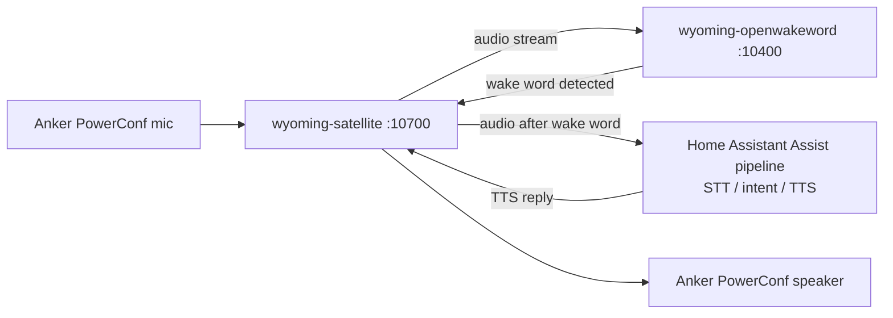

# Wyoming Voice Satellite Setup (this Pi)

This documents exactly how the hands-free Home Assistant voice satellite runs
on this Pi, so it can be rebuilt from scratch if the SD card / OS is ever
reflashed.

This is **independent of the `espresense-pi` project and of the kiosk
config** — it is general OS configuration. Nothing here touches the Chromium
kiosk, openbox autostart or the watchdog.

## What it provides

Two small always-on services turn the Pi plus its USB speakerphone into an
Assist voice satellite with local wake word detection:

| Service | Port | Purpose |
| --- | --- | --- |
| `wyoming-openwakeword` | `127.0.0.1:10400` | Detects the wake word ("ok nabu") locally |
| `wyoming-satellite` | `0.0.0.0:10700` | Captures the mic, plays replies, talks to Home Assistant |

Home Assistant does the heavy work (speech-to-text, intent handling,
text-to-speech). The Pi only listens for the wake word and streams audio after
it fires.



Current state on this Pi:

- `wyoming-satellite` **1.4.1** (from GitHub tag, editable install)
- `wyoming-openwakeword` **2.1.0** (from GitHub tag), `pyopen-wakeword` 1.1.0
- Each installed in its own venv under `/opt` (Python 3.13.5)
- Both run as user `pi` via systemd, enabled at boot
- Audio device: Anker PowerConf (ALSA card name `PowerConf`) for both mic and
  speaker
- No PulseAudio / PipeWire is used — the satellite talks to ALSA directly

## Resource usage (measured on this Pi 4, 4 GB)

| Service | CPU (steady state) | RAM |
| --- | --- | --- |
| `wyoming-openwakeword` | ~40% of one core (about 10% of the whole Pi) | ~45 MB |
| `wyoming-satellite` | ~5% of one core | ~32 MB |

The wake word model is evaluated continuously on the mic stream, so this is a
constant load, not a spike. Kiosk and VS Code Server load come on top of it.

## 1. Install system dependencies

```bash
sudo apt update
sudo apt install -y python3-venv libasound2-dev libopenblas0 git
```

The `pi` user must be in the `audio` group (it is by default).

## 2. Install wyoming-openwakeword

```bash
sudo git clone --depth 1 --branch v2.1.0 \
    https://github.com/rhasspy/wyoming-openwakeword.git /opt/wyoming-openwakeword
sudo chown -R pi:pi /opt/wyoming-openwakeword

cd /opt/wyoming-openwakeword
python3 -m venv .venv
.venv/bin/pip install --upgrade pip
.venv/bin/pip install .
```

## 3. Install wyoming-satellite

Three details differ from the upstream README on Python 3.13:

- The PyPI `wyoming-satellite` is **1.0.0 (Dec 2023)** and far behind GitHub,
  so install from the GitHub tag.
- Upstream pins `zeroconf==0.88.0` and `webrtc-noise-gain==1.2.3`, which have
  no Python 3.13 wheels. Install the satellite with `--no-deps` and add
  current versions of those dependencies by hand.
- Upstream's `pyproject.toml` omits the `wyoming_satellite.utils`
  subpackage from a regular install, so use an **editable** install.

```bash
sudo git clone --depth 1 --branch v1.4.1 \
    https://github.com/rhasspy/wyoming-satellite.git /opt/wyoming-satellite
sudo chown -R pi:pi /opt/wyoming-satellite

cd /opt/wyoming-satellite
python3 -m venv .venv
.venv/bin/pip install --upgrade pip
.venv/bin/pip install --no-deps -e .
.venv/bin/pip install wyoming==1.5.4 pyring-buffer zeroconf 'webrtc-noise-gain==1.3.0'
```

pip prints a "requires zeroconf==0.88.0" conflict warning. It is harmless; the
satellite works with the current `zeroconf`.

`pysilero-vad` (local voice activity detection) is **not** installed. It is
not needed when wake word detection is used, and its pinned `numpy<1.26`
has no Python 3.13 wheel.

Verify:

```bash
/opt/wyoming-satellite/.venv/bin/wyoming-satellite --help | head -3
/opt/wyoming-openwakeword/.venv/bin/wyoming-openwakeword --help | head -3
```

## 4. Test the audio device

Use the ALSA **card name** (`CARD=PowerConf`) instead of the card number, as
card numbers can change between reboots.

```bash
arecord -l    # confirm the card name, e.g. "card 1: PowerConf"

# Record 2 s from the mic, then play a chime on the speaker
arecord -D plughw:CARD=PowerConf,DEV=0 -r 16000 -c 1 -f S16_LE -d 2 /tmp/t.wav
aplay   -D plughw:CARD=PowerConf,DEV=0 /opt/wyoming-satellite/sounds/awake.wav
```

If your device has a different name, change it in the service file below.

## 5. systemd services

`/etc/systemd/system/wyoming-openwakeword.service`:

```ini
[Unit]
Description=Wyoming openWakeWord
After=network-online.target

[Service]
Type=simple
User=pi
WorkingDirectory=/opt/wyoming-openwakeword
ExecStart=/opt/wyoming-openwakeword/.venv/bin/wyoming-openwakeword \
    --uri tcp://127.0.0.1:10400 \
    --preload-model ok_nabu
Restart=always
RestartSec=3

[Install]
WantedBy=multi-user.target
```

`/etc/systemd/system/wyoming-satellite.service`:

```ini
[Unit]
Description=Wyoming Satellite (Wallpanel)
Wants=network-online.target
After=network-online.target wyoming-openwakeword.service
Requires=wyoming-openwakeword.service

[Service]
Type=simple
User=pi
SupplementaryGroups=audio
WorkingDirectory=/opt/wyoming-satellite
ExecStart=/opt/wyoming-satellite/.venv/bin/wyoming-satellite \
    --name 'Wallpanel' \
    --uri tcp://0.0.0.0:10700 \
    --mic-command 'arecord -D plughw:CARD=PowerConf,DEV=0 -r 16000 -c 1 -f S16_LE -t raw' \
    --snd-command 'aplay -D plughw:CARD=PowerConf,DEV=0 -r 22050 -c 1 -f S16_LE -t raw' \
    --mic-auto-gain 5 \
    --mic-noise-suppression 2 \
    --wake-uri tcp://127.0.0.1:10400 \
    --wake-word-name ok_nabu \
    --awake-wav /opt/wyoming-satellite/sounds-padded/awake.wav \
    --done-wav /opt/wyoming-satellite/sounds-padded/done.wav \
    --timer-finished-wav /opt/wyoming-satellite/sounds-padded/timer_finished.wav
Restart=always
RestartSec=3

[Install]
WantedBy=multi-user.target
```

Notes on the options:

- `--wake-uri` / `--wake-word-name` make wake word detection run locally via
  `wyoming-openwakeword`. Other built-in wake words: `hey_jarvis`,
  `alexa`, `hey_mycroft`, `hey_rhasspy`.
- `--mic-auto-gain` and `--mic-noise-suppression` use `webrtc-noise-gain`.
  The PowerConf already does hardware echo cancellation, so these are mild.
  If the wake word is missed, try `--mic-auto-gain 10`; if it triggers on
  background noise, raise `--mic-noise-suppression` (max 4).
- The reply sample rate (`-r 22050`) matches the default Piper TTS output. If
  your TTS sounds too fast or slow, change it.
- `--name` is what Home Assistant shows for the device.
- The `sounds-padded` chimes are created in the next step.

### Padded chimes and speaker volume

The PowerConf drops the start of a sound when it wakes from idle, so the
short stock chimes were completely inaudible while the longer TTS replies
were clear. Prefix each chime with 0.6 s of silence, and set the speaker
volume to 50% (the default was 29%):

```bash
mkdir -p /opt/wyoming-satellite/sounds-padded
python3 - <<'E'
import wave
src = '/opt/wyoming-satellite/sounds/'
dst = '/opt/wyoming-satellite/sounds-padded/'
for n in ('awake', 'done', 'timer_finished'):
    w = wave.open(src + n + '.wav')
    p = w.getparams()
    d = w.readframes(w.getnframes())
    o = wave.open(dst + n + '.wav', 'wb')
    o.setparams(p)
    o.writeframes(b'\0' * (int(p.framerate * 0.6) * p.sampwidth * p.nchannels) + d)
    o.close()
E

amixer -c PowerConf sset PCM 50%
sudo alsactl store    # persist the volume across reboots
```

The satellite mutes the mic for the length of the chime file, so the added
silence also delays when it starts listening after the wake word.

Enable and start:

```bash
sudo systemctl daemon-reload
sudo systemctl enable --now wyoming-openwakeword.service wyoming-satellite.service
```

## 6. Verify

```bash
systemctl is-active wyoming-openwakeword wyoming-satellite
ss -ltn | grep -E ':10700|:10400'
journalctl -u wyoming-satellite -u wyoming-openwakeword -n 20 --no-pager
```

Healthy logs show `Ready` for both services and
`Connected to services` for the satellite.

## 7. Pair with Home Assistant

1. In Home Assistant: **Settings → Devices & services**. The satellite is
   auto-discovered as **Wyoming Protocol** ("Wallpanel"). Click **Configure**.
   If it is not discovered, add the **Wyoming Protocol** integration manually
   with host `192.168.178.20` (or `rpi-4.local`) and port `10700`.
2. Select the Assist **pipeline** (STT, conversation agent and TTS) to use.
3. Say "ok nabu" and speak a command.

A speech-to-text and a text-to-speech add-on (for example Whisper and Piper)
must be available in Home Assistant, or you must use Home Assistant Cloud.

## Troubleshooting

| Symptom | Check |
| --- | --- |
| `Connected to services` never appears | `systemctl status wyoming-openwakeword`; the satellite needs it running |
| Wake word never fires | `journalctl -u wyoming-satellite -f`; try `--mic-auto-gain 10`; check the mic with `arecord` |
| No sound from replies | Test `aplay` with the same `-D` device; check the speaker volume with `alsamixer -c PowerConf` |
| Chimes inaudible but TTS replies are heard | Use the padded chimes and a PCM volume of at least 50% (see above) |
| Speech is transcribed in the wrong language (for example English text for German speech) | Home Assistant side: set the pipeline's speech-to-text language and the Whisper add-on `language` to match; avoid `.en` models |
| Mic or speaker device busy | Another process holds the PowerConf (for example Chromium); `fuser -v /dev/snd/*` |
| Card name differs after reboot | Confirm with `arecord -l`; update `CARD=` in the service file |
| Debug audio and events | Add `--debug` to the satellite `ExecStart` and restart |

## Updating

```bash
cd /opt/wyoming-satellite && sudo -u pi git fetch --tags && sudo -u pi git checkout <new-tag>
sudo systemctl restart wyoming-satellite
```

For `wyoming-openwakeword`, also re-run `.venv/bin/pip install .` after
checking out the new tag, then restart the service.

## Uninstall

```bash
sudo systemctl disable --now wyoming-satellite wyoming-openwakeword
sudo rm /etc/systemd/system/wyoming-satellite.service \
        /etc/systemd/system/wyoming-openwakeword.service
sudo systemctl daemon-reload
sudo rm -rf /opt/wyoming-satellite /opt/wyoming-openwakeword
```
