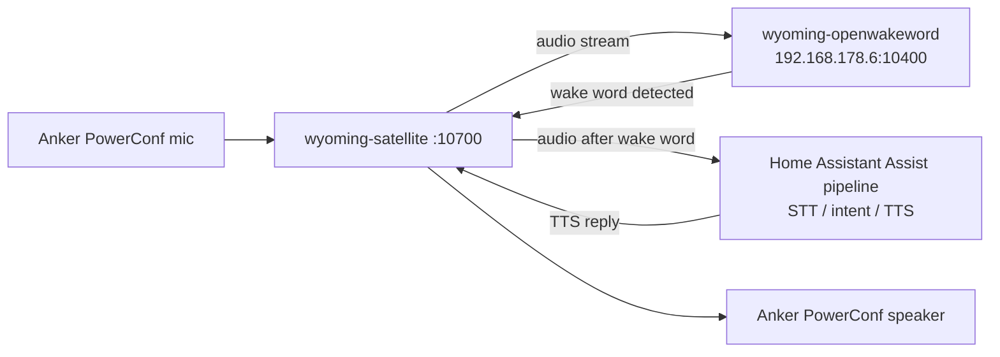

# Wyoming Voice Satellite Setup (this Pi)

This documents exactly how the hands-free Home Assistant voice satellite runs
on this Pi, so it can be rebuilt from scratch if the SD card / OS is ever
reflashed.

This is **independent of the `espresense-pi` project and of the kiosk
config** — it is general OS configuration. Nothing here touches the Chromium
kiosk, openbox autostart or the watchdog.

## What it provides

The satellite runs on this Pi and turns it plus its USB speakerphone into an
Assist voice satellite. Wake word detection runs on the Home Assistant server
(`192.168.178.6`), not on the Pi.

| Service | Where | Port | Purpose |
| --- | --- | --- | --- |
| `wyoming-satellite` | this Pi | `0.0.0.0:10700` | Captures the mic, plays replies, talks to Home Assistant |
| `wyoming-openwakeword` | Docker on `192.168.178.6` | `10400` | Detects the wake word for the satellite |

Home Assistant does the heavy work (speech-to-text, intent handling,
text-to-speech). The Pi streams its mic audio to the wake word service all the
time, and to Home Assistant after the wake word fires.



Current state on this Pi:

- `wyoming-satellite` **1.4.1** (from GitHub tag, editable install) in a venv
  at `/opt/wyoming-satellite` (Python 3.13.5)
- Runs as user `pi` via systemd, enabled at boot
- Wake word: `alexa`, detected by the service on `192.168.178.6:10400`
- Audio device: Anker PowerConf (ALSA card name `PowerConf`) for both mic and
  speaker
- No PulseAudio / PipeWire is used — the satellite talks to ALSA directly

## Resource usage (measured on this Pi 4, 4 GB)

| Service | CPU (steady state) | RAM |
| --- | --- | --- |
| `wyoming-satellite` | ~4% of one core | ~32 MB |

Wake word detection used to run on the Pi and took 35–67% of one core at
1.5 GHz (more when the CPU was underclocked, enough to fall behind real time
at 700 MHz). That is why it moved to the server.

## Wake word service (server side)

`wyoming-openwakeword` runs as a Docker container on the Home Assistant server
(`192.168.178.6`) and listens on port `10400`. The satellite is its only
client. The container offers the built-in models plus custom ones (`Alice`,
`Winston`, `marvin`, `alfred`, `homie`).

Example `docker-compose.yml` (adapt it to the real one; it was not read from
the server):

```yaml
services:
  openwakeword:
    image: rhasspy/wyoming-openwakeword
    restart: unless-stopped
    ports:
      - "10400:10400"
    volumes:
      - ./custom:/custom
```

Check from the Pi that it is reachable and list its models:

```bash
/opt/wyoming-satellite/.venv/bin/python - <<'E'
import asyncio
from wyoming.client import AsyncTcpClient
from wyoming.info import Describe, Info

async def main():
    async with AsyncTcpClient('192.168.178.6', 10400) as c:
        await c.write_event(Describe().event())
        info = Info.from_event(await asyncio.wait_for(c.read_event(), 10))
        print([m.name for p in info.wake for m in p.models])

asyncio.run(main())
E
```

## 1. Install system dependencies

```bash
sudo apt update
sudo apt install -y python3-venv libasound2-dev git
```

The `pi` user must be in the `audio` group (it is by default).

## 2. Install wyoming-satellite

Three details differ from the upstream README on Python 3.13:

- The PyPI `wyoming-satellite` is **1.0.0 (Dec 2023)** and far behind GitHub,
  so install from the GitHub tag.
- Upstream pins `zeroconf==0.88.0` and `webrtc-noise-gain==1.2.3`, which have
  no Python 3.13 wheels. Install the satellite with `--no-deps` and add
  current versions of those dependencies by hand.
- Upstream's `pyproject.toml` omits the `wyoming_satellite.utils`
  subpackage from a regular install, so use an **editable** install.

```bash
sudo git clone --depth 1 --branch v1.4.1 \
    https://github.com/rhasspy/wyoming-satellite.git /opt/wyoming-satellite
sudo chown -R pi:pi /opt/wyoming-satellite

cd /opt/wyoming-satellite
python3 -m venv .venv
.venv/bin/pip install --upgrade pip
.venv/bin/pip install --no-deps -e .
.venv/bin/pip install wyoming==1.5.4 pyring-buffer zeroconf 'webrtc-noise-gain==1.3.0'
```

pip prints a "requires zeroconf==0.88.0" conflict warning. It is harmless; the
satellite works with the current `zeroconf`.

`pysilero-vad` (local voice activity detection) is **not** installed. It is
not needed when wake word detection is used, and its pinned `numpy<1.26`
has no Python 3.13 wheel.

Verify:

```bash
/opt/wyoming-satellite/.venv/bin/wyoming-satellite --help | head -3
```

## 3. Test the audio device

Use the ALSA **card name** (`CARD=PowerConf`) instead of the card number, as
card numbers can change between reboots.

```bash
arecord -l    # confirm the card name, e.g. "card 1: PowerConf"

# Record 2 s from the mic, then play a chime on the speaker
arecord -D plughw:CARD=PowerConf,DEV=0 -r 16000 -c 1 -f S16_LE -d 2 /tmp/t.wav
aplay   -D plughw:CARD=PowerConf,DEV=0 /opt/wyoming-satellite/sounds/awake.wav
```

If your device has a different name, change it in the service file below.

## 4. systemd service

`/etc/systemd/system/wyoming-satellite.service`:

```ini
[Unit]
Description=Wyoming Satellite (Wallpanel)
Wants=network-online.target
After=network-online.target

[Service]
Type=simple
User=pi
SupplementaryGroups=audio
WorkingDirectory=/opt/wyoming-satellite
ExecStart=/opt/wyoming-satellite/.venv/bin/wyoming-satellite \
    --name 'Wallpanel' \
    --uri tcp://0.0.0.0:10700 \
    --mic-command 'arecord -D plughw:CARD=PowerConf,DEV=0 -r 16000 -c 1 -f S16_LE -t raw' \
    --snd-command 'aplay -D plughw:CARD=PowerConf,DEV=0 -r 22050 -c 1 -f S16_LE -t raw' \
    --mic-volume-multiplier 5 \
    --mic-auto-gain 5 \
    --mic-noise-suppression 2 \
    --wake-uri tcp://192.168.178.6:10400 \
    --wake-word-name alexa \
    --awake-wav /opt/wyoming-satellite/sounds-padded/awake.wav \
    --done-wav /opt/wyoming-satellite/sounds-padded/done.wav \
    --timer-finished-wav /opt/wyoming-satellite/sounds-padded/timer_finished.wav
Restart=always
RestartSec=3

[Install]
WantedBy=multi-user.target
```

Notes on the options:

- `--wake-uri` / `--wake-word-name` send the mic audio to the wake word
  service on the server; the satellite plays the chime and starts the
  pipeline when that service reports `alexa`. Built-in names: `okay_nabu`
  (not `ok_nabu`), `hey_jarvis`, `alexa`, `hey_mycroft`, `hey_rhasspy`; the
  server also offers custom models (see the server section).
- Custom models are added on the server (the container's custom model dir),
  not on the Pi; the file name without `.tflite` is the wake word name. A
  `homie.tflite` from `dev-ath0m/OpenWakeWordForLocalWindows` was tried
  locally and never detected anything: pyopen_wakeword reads an input window
  count of 96 from it (the standard models use 16). Use a model trained for
  openWakeWord with the standard 16x96 input.
- `--mic-volume-multiplier 5` multiplies the mic samples by 5 (about +14 dB)
  before wake word detection. The PowerConf's capture level is already at its
  hardware maximum and speech arrives at only about -45 dBFS, so extra gain
  has to be added in software. Lower it (try 3) if audio distorts or the
  wake word triggers on background noise; raise it (try 8) if it is missed.
- `--mic-auto-gain` and `--mic-noise-suppression` use `webrtc-noise-gain`.
  The PowerConf already does hardware echo cancellation, so these are mild.
  If the wake word is missed, try `--mic-auto-gain 10`; if it triggers on
  background noise, raise `--mic-noise-suppression` (max 4).
- The reply sample rate (`-r 22050`) matches the default Piper TTS output. If
  your TTS sounds too fast or slow, change it.
- `--name` is what Home Assistant shows for the device.
- The `sounds-padded` chimes are created in the next step.

### Padded chimes and speaker volume

The PowerConf drops the start of a sound when it wakes from idle, so the
short stock chimes were completely inaudible while the longer TTS replies
were clear. Prefix each chime with 0.6 s of silence, and set the speaker
volume to 50% (the default was 29%):

```bash
mkdir -p /opt/wyoming-satellite/sounds-padded
python3 - <<'E'
import wave
src = '/opt/wyoming-satellite/sounds/'
dst = '/opt/wyoming-satellite/sounds-padded/'
for n in ('awake', 'done', 'timer_finished'):
    w = wave.open(src + n + '.wav')
    p = w.getparams()
    d = w.readframes(w.getnframes())
    o = wave.open(dst + n + '.wav', 'wb')
    o.setparams(p)
    o.writeframes(b'\0' * (int(p.framerate * 0.6) * p.sampwidth * p.nchannels) + d)
    o.close()
E

amixer -c PowerConf sset PCM 50%
sudo alsactl store    # persist the volume across reboots
```

The satellite mutes the mic for the length of the chime file, so the added
silence also delays when it starts listening after the wake word.

Enable and start:

```bash
sudo systemctl daemon-reload
sudo systemctl enable --now wyoming-satellite.service
```

## 5. Verify

```bash
systemctl is-active wyoming-satellite
ss -tn | grep -E '192.168.178.6:10400|:10700'    # server wake word + Home Assistant
journalctl -u wyoming-satellite -n 20 --no-pager
```

Healthy logs show `Ready`, `Connected to services`, `Connected to server` and
`Waiting for wake word`.

## 6. Pair with Home Assistant

1. In Home Assistant: **Settings → Devices & services**. The satellite is
   auto-discovered as **Wyoming Protocol** ("Wallpanel"). Click **Configure**.
   If it is not discovered, add the **Wyoming Protocol** integration manually
   with host `192.168.178.20` (or `rpi-4.local`) and port `10700`.
2. Select the Assist **pipeline** (STT, conversation agent and TTS) to use.
3. Say "Alexa" and speak a command.

A speech-to-text and a text-to-speech add-on (for example Whisper and Piper)
must be available in Home Assistant, or you must use Home Assistant Cloud.

## CPU clock

The Pi 4 used to be underclocked (`powersave` governor, `arm_freq=1000`,
`arm_freq_min=700`). After a fan was added (`dtoverlay=gpio-fan,gpiopin=14,temp=60000`
in `config.txt`) the limits were removed:

- The lines `arm_boost=0`, `arm_freq=1000`, `gpu_freq=700` and
  `arm_freq_min=700` were deleted from `/boot/firmware/config.txt` (backup:
  `/boot/firmware/config.txt.bak-underclock`).
- `cpu-governor.service`, which forced `powersave`, is disabled (the unit file
  is kept), so the default `ondemand` governor runs.

A reboot is needed after changing `config.txt`. Check with
`vcgencmd measure_clock arm` (about 1.5 GHz under load) and
`vcgencmd get_throttled` (`0x0` means no throttling or under-voltage).

## Wake word tuning results

Measured with the author's German-accented voice on this PowerConf:

- **Mic signal:** clean but quiet. Speech sits around -45 dBFS RMS, the
  PowerConf's built-in noise gate drops the background to about -90 dBFS, and
  nothing clips. The capture level is already at 100%.
- **`okay_nabu`:** detected only 2 of 5 attempts at the default threshold 0.5,
  with no better result at 0.3. Lower thresholds (0.2) caught about one more
  recording but risk false triggers.
- **Digital gain:** adding +10 to +30 dB or the satellite's gain/noise
  processing to the recordings did not change detection, so the level is not
  the limit. The model fits the pronunciation poorly.
- **Local `homie.tflite`:** 0 of 9 tests, with or without gain.

The cheap way to compare wake words is one recording per round: play a cue
tone, record about 4 s, run the file through a test `wyoming-openwakeword`
instance and note whether it reports a detection.

## Troubleshooting

| Symptom | Check |
| --- | --- |
| `Connected to services` never appears or `Unexpected error in wake read task` | The wake word service on `192.168.178.6:10400` is unreachable; check `ping 192.168.178.6`, `nc -vz 192.168.178.6 10400` and the container |
| Wake word is missed often | The speech level is low and the model fits the voice poorly: raise `--mic-volume-multiplier`, try another wake word (`--wake-word-name`), see "Wake word tuning results"; check the mic with `arecord` |
| No sound from replies | Test `aplay` with the same `-D` device; check the speaker volume with `alsamixer -c PowerConf` |
| Chimes inaudible but TTS replies are heard | Use the padded chimes and a PCM volume of at least 50% (see above) |
| Speech is transcribed in the wrong language (for example English text for German speech) | Home Assistant side: set the pipeline's speech-to-text language and the Whisper add-on `language` to match; avoid `.en` models |
| Mic or speaker device busy | Another process holds the PowerConf (for example Chromium); `fuser -v /dev/snd/*` |
| Card name differs after reboot | Confirm with `arecord -l`; update `CARD=` in the service file |
| `arecord: audio open error: No such device` / `Mic service disconnected` every 3 s | The PowerConf is not connected, so the satellite restarts its mic command in a loop. Disable it while the PowerConf is absent (`sudo systemctl disable --now wyoming-satellite`) and re-enable once `arecord -l` lists it |
| Wake word never fires although the service is "Waiting for wake word" | The PowerConf's hardware mute is on (red LED; the capture mixer still says `[on]`). Record a few seconds with `arecord -D plughw:CARD=PowerConf,DEV=0 -r 16000 -c 1 -f S16_LE -d 4 /tmp/m.wav`: all-zero samples mean it is muted |
| PowerConf volume/mute buttons switch off the WallPanel screensaver (HA boolean goes off) | The buttons show up as an X keyboard, and WallPanel stops the screensaver on any keydown. `~/.config/openbox/rc.xml` grabs `XF86Audio*` keys so Chromium never sees them: volume up/down and mute run `amixer -c PowerConf sset PCM 5%+ / 5%- / toggle`, other media keys do nothing. Reload with `openbox --reconfigure` |
| Debug audio and events | Add `--debug` to the satellite `ExecStart` and restart |

## Updating

```bash
cd /opt/wyoming-satellite && sudo -u pi git fetch --tags && sudo -u pi git checkout <new-tag>
sudo systemctl restart wyoming-satellite
```

The wake word service is updated on the server (pull the new
`rhasspy/wyoming-openwakeword` image and restart the container).

## Uninstall

```bash
sudo systemctl disable --now wyoming-satellite
sudo rm /etc/systemd/system/wyoming-satellite.service
sudo systemctl daemon-reload
sudo rm -rf /opt/wyoming-satellite
```
